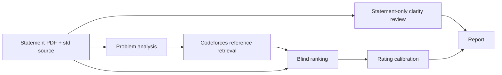

<div align="center">

# XCPC-ProblemJudger

**Statement clarity review and Codeforces difficulty estimation for ICPC/CCPC-style problems**

[](pyproject.toml)
[](https://github.com/MaxDYF/XCPC-Program-Judger/actions/workflows/ci.yml)
[](LICENSE)

[简体中文](docs/README-CN.md) · [Quick Start](#-quick-start) · [How It Works](#-how-it-works) · [Validation](#-validation)

</div>

---

## 📢 Project Status

The web app, command-line interface, asynchronous job tracking, and persistent report history are available. A completed report contains two separate results: a **0–5 statement clarity grade** and an **estimated Codeforces rating**. The rating is an estimate derived from reference problems; it is neither an official Codeforces rating nor a proof that the submitted solution is correct.

## 🌟 Highlights

- **Two independent assessments.** Clarity evaluates whether a contestant understands the task; difficulty estimates a Codeforces rating. The scores are never combined.
- **Reference-based calibration.** Select 5–20 similarly tagged Codeforces problems across a rating gradient. The submitted problem is excluded if it appears among the references.
- **Author-editorial retrieval.** The service reads each reference statement and linked author editorial, verifies a complete program, and skips unusable references. Unusual editorial formats can be handled by a dedicated extraction agent.
- **Blind multi-round ranking.** The ranking agent receives anonymous statements and programs without tags, ratings, IDs, URLs, or retrieval notes. Conflicting rankings are reconciled against the reference gradient and reported.
- **Live web workflow.** Refreshing a submission tab restores its job progress. The history page shows running jobs and completed reports. Reports are written in Chinese; source quotations can retain their original language.

---

## 🎬 Overview

Upload a complete statement PDF and a reference solution source file. The service analyzes the problem, reviews the statement on its own, retrieves Codeforces references, ranks anonymous problem–solution pairs, and calibrates the submitted problem against known ratings.



The clarity path does not receive the uploaded solution or an editorial. The blind ranking path does not receive reference IDs, ratings, tags, or the clarity result.

---

## 🚀 Quick Start

### Environment

Python 3.11 or newer is required. The configured model endpoint must support Chat Completions JSON responses and enough context for complete reference material.

```bash
git clone https://github.com/MaxDYF/XCPC-Program-Judger.git
cd XCPC-Program-Judger
python -m venv .venv
.venv/bin/pip install -e '.[test]'
export OPENAI_API_KEY='replace-with-your-own-key'
export OPENAI_BASE_URL='https://your-compatible-endpoint.example/v1'
```

The API key is read from the process environment and held in memory for requests to the configured model endpoint. Keep filled environment files outside the repository. Analysis, interpretation, extraction, and formatting default to `gpt-6-luna`; blind ranking (`JUDGE_MODEL`) and clarity grading (`CLARITY_MODEL`) default to `gpt-6-sol`. Individual roles can be configured with `OPENAI_MODEL`, `ANALYST_MODEL`, `INTERPRETER_MODEL`, `EXTRACTOR_MODEL`, and `FORMAT_MODEL`.

### Web App

```bash
deploy/run-sandbox.sh
# Open http://127.0.0.1:8765/
```

The Bubblewrap launcher exposes a read-only runtime and source tree, a private temporary directory, and write access to `data/` for SQLite history. It shares the host network. For a Cloudflare Tunnel deployment, keep the service bound to `127.0.0.1` and set `AUTOJUDGER_PUBLIC_HOST` to the exact public hostname. The default Host allowlist accepts loopback names only. A container alternative is provided in [Dockerfile](Dockerfile).

### Command Line

```bash
.venv/bin/xcpc-problemjudger problem.pdf std.cpp --references 12 --output report.json
```

### HTTP API

```bash
curl -H 'X-XCPC-ProblemJudger-Request: 1' \
  -F statement_pdf=@problem.pdf \
  -F std_file=@std.cpp \
  -F reference_count=12 \
  http://127.0.0.1:8765/evaluate
```

The web UI submits through `POST /jobs` and polls `GET /jobs/{job_id}`. `GET /api/jobs` lists queued and running jobs. `POST /evaluate` is a synchronous JSON endpoint. `GET /api/history` and `GET /api/history/{id}` return completed reports. The browser stores the active task ID in session storage, so refreshing the same tab resumes its progress view. Jobs continue on the server after a tab closes, but a server restart interrupts in-progress jobs.

---

## 🧠 How It Works

### Statement Clarity

An interpretation agent reads only the uploaded statement and restates the task without outside cultural context. A clarity judge then grades four criteria as integers from 0 to 5:

| Criterion | Weight |
| --- | ---: |
| Task and input/output | 20% |
| Language | 35% |
| Information density | 10% |
| Background independence | 35% |

The weighted result is rounded to an integer grade. Grades 0 through 5 correspond to **strong reject**, **reject**, **weak reject**, **weak accept**, **accept**, and **strong accept**; grade 3 is the acceptance threshold. The rubric asks whether an ICPC/CCPC contestant can understand *what the task requires*. It does not grade the ease or clarity of the solution.

### Difficulty Calibration

1. Analyze the uploaded statement and `std` source to infer tags, algorithm, and complexity.
2. Retrieve 5–20 similarly tagged Codeforces references across available ratings. Read their statements and linked author editorials. Up to four candidate problems are fetched concurrently.
3. Verify complete reference programs. A fallback extraction agent may locate code in unusual layouts, but the result must match source text or an allowed source link. Skip incomplete references.
4. Ask an independent agent to rank anonymous statement–program pairs in three rounds by default, without web tools or metadata.
5. Fit pairwise votes to the reference rating gradient using a minimum-conflict insertion and monotonic regression. Use neighboring reference ratings to estimate the submitted problem's rating, rounded to a 100-point band.

The report exposes raw ranks, inversions against the reference gradient, equally optimal insertion positions, and extrapolation at a gradient edge. A 0–100 gradient position is supplementary; the **difficulty score is the estimated Codeforces rating**. Individual Codeforces ratings are noisy, and a model can recognize a problem from its statement or code despite input isolation.

---

## 🔒 Deployment and Data Handling

Public access requires no account. PDFs are limited to **10 pages and 20 MiB**; source files are limited to **1 MiB**. A source IP may submit at most **five PDFs per sliding ten-minute window** across both submission endpoints. Writes require the custom request header and pass a same-origin check. The limit is held in one process's memory; multi-instance deployments need a shared or edge-side limiter.

`AUTOJUDGER_HISTORY_DB` selects the SQLite path; its default is `data/history.sqlite3`. The database stores completed reports, not uploaded PDFs or source files. **Completed reports and live task states are public through the web UI.** In-progress jobs live in server memory and disappear after a restart. The configured model service receives uploaded statements and source code for evaluation; review its data policy before processing confidential problems.

The Git repository excludes `data/`, uploads, reports, private reference manifests, PDFs, SQLite databases and journal files, private keys, and filled environment files. Run `python scripts/check_release.py` to scan the actual Git index before publishing. A forced addition or an earlier Git commit still requires manual review.

### Reference Provenance

Live mode uses Codeforces problem metadata, problem pages, author Tutorial links, and editorial entries. An editorial may contain full code, a partial snippet, a shared template, or a submission link. Retrieved editorial programs are not formal platform-provided `std` files. Access restrictions and layout changes can reduce usable references.

`REFERENCE_MANIFEST` can point to an operator-reviewed JSON corpus **outside** the repository. Each entry needs `contestId`, `index`, `name`, `rating`, `tags`, `statement`, `source`, and `editorialUrl`. Redistribute third-party statements and code only with appropriate rights. The service refuses a difficulty estimate if reference coverage or density is insufficient.

---

## ✅ Validation

```bash
.venv/bin/pytest -q
.venv/bin/python scripts/check_release.py
PYTHONPATH=src .venv/bin/python scripts/verify_codeforces_sample.py
```

Unit tests use fake agents and references to exercise scoring weights, input isolation, calibration, editorial extraction, and PDF validation without paid model calls. The live sample script requires model credentials. On 2026-10-18, it attempted 20 Codeforces references and verified 10 across CF 800–2200. The [metadata-only audit](validation/codeforces-sample.json) records URLs, lengths, hashes, and failure reasons without retaining statements, code, or keys. A [historical end-to-end smoke result](validation/end-to-end-smoke.json) used an earlier 10-point clarity rubric and is not a current 5-point result. Neither sample establishes population-level rating accuracy.

---

## 🤝 Contributing

See [CONTRIBUTING.md](CONTRIBUTING.md) for changes and test expectations, and [SECURITY.md](SECURITY.md) for private vulnerability reporting. Please use synthetic fixtures and avoid committing credentials, user uploads, or full third-party problem content.

## 📘 License

XCPC-ProblemJudger is released under the [MIT License](LICENSE). Codeforces statements, editorials, and source programs retain their original rights and are not included here in full.
