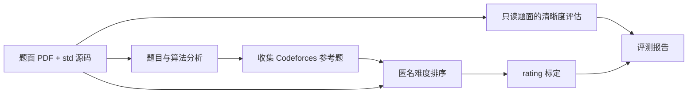

<div align="center">

# XCPC-ProblemJudger

**XCPC题目评分器：评估 ICPC/CCPC 题面清晰度，估计 Codeforces 难度分**

[](../pyproject.toml)
[](https://github.com/MaxDYF/XCPC-Program-Judger/actions/workflows/ci.yml)
[](../LICENSE)

[English](../README.md) · [快速开始](#-快速开始) · [工作原理](#-工作原理) · [测试](#-测试)

</div>

---

XCPC题目评分器接收题面 PDF 和对应 std 源码，输出**0–5 整数档位的题面清晰度**与**估计 Codeforces rating**。网页和命令行使用同一套评测流程。难度分不是 Codeforces 官方定级，也不能证明上传的 std 正确。

## 🌟 功能亮点

- **两项独立评估。** 清晰度评判选手能否理解任务，难度估计 Codeforces rating；两者不合并。
- **参考题标定。** 按相近标签和难度梯度抽取 5–20 道 Codeforces 题；若抽到上传题本身，会排除并补选。
- **出题人题解来源。** 读取参考题题面及题页链接的官方 Tutorial，提取并核验完整程序；非标准排版由专门的提取 agent 辅助，材料不足时跳过。
- **多轮匿名排序。** 排序 agent 只看匿名题面与程序，不接收标签、rating、题号、URL 或检索记录；报告展示它与参考题难度梯度的分歧。
- **持续的网页任务。** 刷新提交页面可恢复进度，历史页显示进行中的任务和已完成报告。分析文字使用中文，引用原文可保留原语言。

---

## 🎬 项目概览

上传完整题面 PDF 和对应 std 源码后，系统分析题意与做法，单独评估题面是否清楚，再收集 Codeforces 参考题，对匿名题面与程序排序，最后依据参考题 rating 校准难度。



清晰度链路不会收到上传的 std 或题解。盲排链路不会收到参考题标签、rating、题号、URL 或清晰度结果。

---

## 🚀 快速开始

### 安装环境

需要 Python 3.11 或更新版本。模型接口需兼容 Chat Completions JSON 响应，并有足够上下文容纳完整参考材料。

```bash
git clone https://github.com/MaxDYF/XCPC-Program-Judger.git
cd XCPC-Program-Judger
python -m venv .venv
.venv/bin/pip install -e '.[test]'
export OPENAI_API_KEY='replace-with-your-own-key'
export OPENAI_BASE_URL='https://your-compatible-endpoint.example/v1'
```

`OPENAI_API_KEY` 从进程环境变量读取，在内存中用于请求所配置的模型服务。不要把填好密钥的环境文件提交到仓库。题目分析、去背景解释、题解提取和中文润色默认使用 `gpt-6-luna`；盲排 `JUDGE_MODEL` 与清晰度评分 `CLARITY_MODEL` 默认使用 `gpt-6-sol`。可通过 `OPENAI_MODEL`、`ANALYST_MODEL`、`INTERPRETER_MODEL`、`EXTRACTOR_MODEL` 和 `FORMAT_MODEL` 分别覆盖角色模型。

### 网页

```bash
deploy/run-sandbox.sh
# 打开 http://127.0.0.1:8765/
```

Bubblewrap 启动脚本将运行时和源码只读挂载，为程序提供独立的临时目录，只开放 `data/` 供 SQLite 历史库写入；它仍与宿主机共享网络。通过 Cloudflare Tunnel 发布时，应保持服务监听 `127.0.0.1`，并把 `AUTOJUDGER_PUBLIC_HOST` 设为自己的准确公网域名。默认 Host 白名单只接受本机地址。容器方案见 [Dockerfile](../Dockerfile)。

### 命令行

```bash
.venv/bin/xcpc-problemjudger problem.pdf std.cpp --references 12 --output report.json
```

### HTTP API

```bash
curl -H 'X-XCPC-ProblemJudger-Request: 1' \
  -F statement_pdf=@problem.pdf \
  -F std_file=@std.cpp \
  -F reference_count=12 \
  http://127.0.0.1:8765/evaluate
```

网页通过 `POST /jobs` 创建任务，并轮询 `GET /jobs/{job_id}`；`GET /api/jobs` 展示排队和进行中的任务。`POST /evaluate` 提供同步 JSON 接口。`GET /api/history` 与 `GET /api/history/{id}` 返回已完成报告。浏览器在当前标签的 sessionStorage 中保存任务 ID，刷新后可以恢复进度；关闭标签不会取消服务器任务，但服务进程重启会中断进行中的任务。

---

## 🧠 工作原理

### 题面清晰度

去背景理解 agent 只阅读原题面，写出不依赖题外背景知识的任务含义。独立评分 agent 再将四项指标分别评为 0–5 的整数：

| 指标 | 权重 |
| --- | ---: |
| 任务及输入输出 | 20% |
| 语言表述 | 35% |
| 有效信息集中度 | 10% |
| 背景独立性 | 35% |

加权结果四舍五入为整数档位。0–5 分依次对应 **strong reject**、**reject**、**weak reject**、**weak accept**、**accept**、**strong accept**；3 分是接受档位的起点。评判对象是一般 ICPC/CCPC 选手能否理解题目**要做什么**，不评价算法是否容易想到。对于选手合理掌握的竞赛常识无需扣分；超出常识的概念如果在题面中解释充分，也无需单独扣分。

### 难度标定

1. 阅读上传题面和 std，推断算法、复杂度和 Codeforces 标签。
2. 从可用题目中选取 5–20 道相近标签的参考题，形成 rating 梯度；最多并行读取 4 道候选题的题面和出题人题解。
3. 核验参考题的完整程序。格式异常时由提取 agent 找出原文中确实存在的代码或允许的源码链接；只有片段或材料不足的题目会跳过。
4. 独立 agent 默认进行 3 轮匿名排序，不使用网页工具，不接收检索元数据。
5. 将成对排序结果按最少冲突插入和单调回归拟合到参考题 rating 梯度，再用相邻参考题 rating 估计上传题的难度，按 100 分档取整。

报告披露原始顺位、参考题顺序逆转率、同样最优的插入位置，以及梯度边缘的外推情况。0–100 的梯度位置仅为辅助指标；**难度分为估计 Codeforces rating**。Codeforces rating 不是逐题真实难度的严格全序，模型也可能从题面或程序认出原题，因此盲排只是输入隔离。

---

## 🔒 部署与数据处理

网页公开访问，不需要账号。PDF 最多 **10 页、20 MiB**，std 文件最多 **1 MiB**。同一来源 IP 在滑动的 10 分钟窗口内，最多提交 **5 次 PDF**，两个提交接口共用配额。写操作须附自定义请求头，并通过同源检查。限流计数存在单进程内存中；多实例部署需要共享计数或边缘限流。

`AUTOJUDGER_HISTORY_DB` 可指定 SQLite 文件路径，默认是 `data/history.sqlite3`。历史库保存完成的评分报告，不保存上传的 PDF 或 std。**完成报告和进行中任务状态在网页上公开可读。** 运行中任务只保存在服务进程内存里，重启会清除。上传题面和程序会按业务需要发送到配置的模型服务；处理未公开题目之前，请确认该服务的数据处理方式。

Git 仓库排除 `data/`、上传文件、报告、私有参考语料、PDF、SQLite 数据库及其临时文件、私钥和填好内容的环境文件。发布前运行 `python scripts/check_release.py` 检查实际 Git 暂存区；曾经的提交记录和强制添加文件仍需人工核对。

### 参考材料来源

实时模式读取 Codeforces 题目元数据、题页、出题人 Tutorial 链接及题解条目。题解可能包含完整代码、片段、共用模板或提交链接。抽取出的程序并非平台统一提供的正式 std。访问限制和页面格式变化会降低可用参考题数量。

`REFERENCE_MANIFEST` 可指向**仓库外**经管理员审核的 JSON 语料。每项需要 `contestId`、`index`、`name`、`rating`、`tags`、`statement`、`source` 和 `editorialUrl`。转载第三方题面和代码需遵守相应权利要求。参考题 rating 覆盖或密度不足时，服务会拒绝给出难度估计。

---

## ✅ 测试

```bash
.venv/bin/pytest -q
.venv/bin/python scripts/check_release.py
```

测试套件可在本地运行，不需要模型凭据。发布检查会扫描 Git 暂存区中的私有数据和疑似密钥。若需单独检查实时 Codeforces 读取功能，请配置模型凭据后运行 `PYTHONPATH=src .venv/bin/python scripts/verify_codeforces_sample.py`。

---

## 🤝 参与贡献

修改和测试要求见 [CONTRIBUTING.md](../CONTRIBUTING.md)，私下报告安全问题见 [SECURITY.md](../SECURITY.md)。测试请使用合成材料，不提交凭据、用户上传内容或未经许可转载的第三方题面与源码。

## 📘 许可证

XCPC-ProblemJudger 采用 [MIT License](../LICENSE)。Codeforces 题面、题解和源码仍归原权利人所有，仓库不收录其全文。
